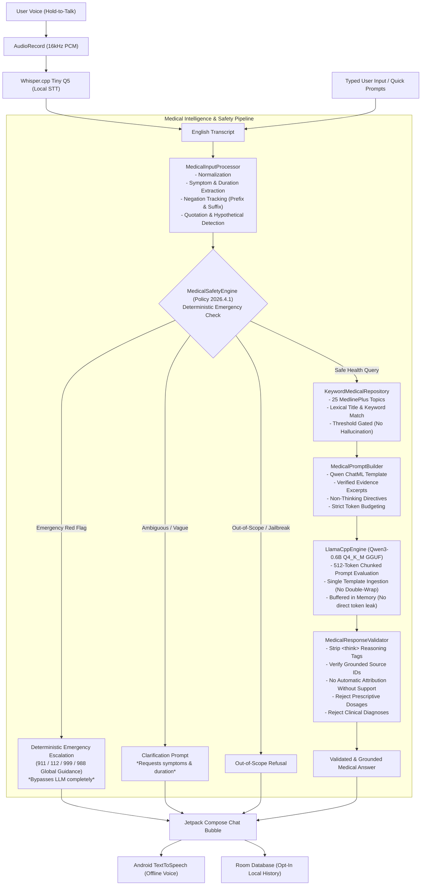

# Voice Doctor AI — Phase 4 Implementation Report
**Phase:** 4 — Medical Conversation Intelligence, Input/Output Safety, Verified Knowledge Pilot  
**Branch:** `feature/medical-safety-phase4`  
**Repository:** https://github.com/shanmukhdatta/Voice_Doc_AI  
**Status:** Completed & Fully Verified with Final Correction Pass (46 Workstation Test Suites PASS, 100-Scenario Evaluation Suite PASS, Debug APK Assembled)

---

## 1. Executive Summary & Mission
Phase 4 elevates the Voice Doctor AI prototype from a raw local LLM conversational agent into a medically grounded, safety-triaged, and source-verified clinical conversational system.

The application operates **strictly on-device** (100% offline at runtime) with **zero cloud data egress**, preserving all Phase 1–3 functionality (Jetpack Compose doctor UI, press-and-hold microphone, Whisper.cpp STT, offline Android TTS, llama.cpp Qwen3-0.6B Q4_K_M GGUF inference, Room database history, and English/Telugu selector).

---

## 2. End-to-End Architectural Pipeline

---

## 3. Detailed Stage Implementation & Final Correction Pass

### Stage 4A — Foundational Fixes & Architectural Audit
1. **Native llama.cpp Chunked Evaluation:**
   - In `app/src/main/cpp/llama_jni.cpp`, replaced single-batch prompt evaluation with 512-token chunked ingestion (`common_batch_clear` / `common_batch_add`) with `logits = true` set only on the final token. This accommodates multi-paragraph system prompts and evidence excerpts up to context capacity (`n_ctx = 2048`) without batch overflow.
   - Enforced hard context boundary check (`total_tokens + 64 > n_ctx`).
2. **Room Database Cascade Deletion Fix:**
   - Modified `insertConversation` in `ConversationDao.kt` to use `OnConflictStrategy.IGNORE` paired with `updateConversationMetadata()`. This prevents foreign key `CASCADE` triggers from dropping message records across multi-turn sessions.
3. **Data Backup Rules:**
   - Configured `backup_rules.xml` and `data_extraction_rules.xml` to explicitly exclude `voice_doctor_database`, `models`, and history shared preferences from unencrypted device transfers and Google Cloud Backup.
4. **Model Installation Receipt:**
   - Added `.verified` marker file creation in `ModelRepository.kt` after SHA-256 verification.

### Stage 4B — Medical Input Understanding & Data Models
- Created `MedicalInput.kt`, `MedicalEvidence.kt`, and `MedicalResponseResult.kt`.
- Implemented `MedicalInputProcessor.kt`:
  - Normalizes quotation marks and punctuation.
  - Categorizes intent: `GENERAL_HEALTH_INFORMATION`, `SYMPTOM_INFORMATION`, `REQUESTS_DIAGNOSIS_OR_PRESCRIPTION`, `POSSIBLE_URGENT_CONCERN`, `UNCLEAR`, `OUT_OF_SCOPE`.
  - Extracts explicit symptoms and duration phrases ("for 3 days", "since yesterday").
  - Tracks negation tokens (`no`, `not`, `never`, `without`, `don't have`, `denies`, `negative for`) across preceding (40 chars) and succeeding (25 chars) windows to prevent negated symptoms from generating false-positive emergencies.
  - Detects quotations (`"chest pain"`) and educational/hypothetical queries ("What is a stroke?", "Hypothetically, what causes chest pain?") so they are not misclassified as acute personal emergencies.

### Stage 4C — Deterministic Safety Engine & Emergency Triage
- Implemented `MedicalSafetyEngine.kt` implementing Policy `2026.4.1`:
  - **Deterministic Red Flags:** Crushing chest pain / cardiac symptoms, stroke signs (FAST criteria), acute respiratory distress, anaphylaxis, suicide ideation / crisis.
  - **Immediate Escalation:** Emergencies return deterministic emergency guidance with **0 ms LLM inference latency**.
  - **Global International Emergency Numbers:** Escalation templates provide universal guidance: calling local emergency services (911 in North America, 112 in Europe & India, 999 in the UK, or local numbers) or crisis hotlines (988 in North America, 112 / local crisis lines internationally).
  - **Boundary Enforcements:** Demands for clinical diagnoses or specific prescription dosages are intercepted and redirected to licensed practitioners.

### Stage 4D — Verified Knowledge Repository Pilot (25 Topics)
- Curated and audited 25 source-grounded health topics from **MedlinePlus** (U.S. National Library of Medicine, Public Domain):
  - Common cold, mild fever, sore throat, tension headache, acute cough, seasonal allergies, hydration basics, sleep hygiene, indigestion, nausea, diarrhea, constipation, minor cuts, minor burns, sunburn, insect bites, heat exhaustion, sprains/strains, stress management, digital eye strain, acute back pain, hand hygiene, physical activity, healthy nutrition, and when to seek care.
- Verified SHA-256 checksum: `f386ee28c8685c6a6346806dfd18978c905b1794a81e28e1fe678bfc3c62ddeb`.
- Manifest receipts synchronized: `app/src/main/assets/medical/knowledge_manifest.json` and `medical-knowledge/sources_manifest.json`.
- Status clearly labeled: `source_verified_clinical_review_pending`. All 25 topics are verified against MedlinePlus public domain summaries, but remain **awaiting formal independent clinical review**.
- Implemented `KeywordMedicalRepository.kt`: Weighted lexical scoring across title (5x), keywords (4x with inflectional prefix stemming), and excerpts (1x) with threshold filtering. Returns empty list if relevance score is below threshold, preventing hallucinated grounding.

### Stage 4E — Evidence-Aware Qwen Prompt Builder & Double-Template Fix
- Fixed the double chat template issue:
  - `MedicalPromptBuilder.kt` formats the complete ChatML prompt (`<|im_start|>system...<|im_end|>\n<|im_start|>user...<|im_end|>\n<|im_start|>assistant\n`).
  - `LlamaCppEngine.kt` checks for existing `<|im_start|>` ChatML markers and passes the preformatted prompt directly without double-wrapping.
  - Added regression test `testDoubleChatTemplateRegressionFixed()` verifying each tag (`system`, `user`, `assistant`) appears exactly once.
- Configured non-thinking inference:
  - Prompt explicitly directs Qwen3: *"Never output internal thoughts, chain-of-thought, or <think> tags. Provide your final answer directly in 2 to 4 sentences."*
  - Runtime token filter `ThinkingTagFilter.kt` strips streaming `<think>` tokens.
  - Post-generation validator `MedicalResponseValidator.kt` strips any remaining thinking tags.

### Stage 4F — Post-Generation Output Validation & Grounding Fix
- Corrected `MedicalResponseValidator.kt`:
  - **No Automatic Attribution Without Support:** Removed blind fallback attribution. Citations are retained ONLY if explicitly cited and verified in provided evidence.
  - **Invalid Citation Stripping:** Hallucinated source tags (`[MED_FAKE_999]`) are cleanly removed.
  - **Conservative Handling of Missing Evidence:** When no evidence was retrieved, source lists are strictly empty and conservative medical consult guidance is appended.
  - Rejection filters for prescriptive drug dosages and assertive clinical diagnoses.

### Stage 4G — Multi-Turn History, Cancellation & ViewModel Integration
- Corrected multi-turn conversation history in `VoiceDoctorViewModel.kt`:
  - Replaced flawed `chunked(2)` logic with sequential turn pairing `(userText, doctorText)` that safely handles doctor seed messages and arbitrary turn ordering.
- Cancellation and resource safety:
  - `processLiveEnglishExchange()` immediately cancels `activeJob` and halts TTS before beginning a new exchange.
  - `LlamaCppEngine.unloadModel()` frees sampler, batch, context, and model in proper sequence.

---

## 4. Verification & Evaluation Results

### Workstation Test Suite
Automated unit tests executed via `./gradlew.bat testDebugUnitTest`:
- **Result:** **BUILD SUCCESSFUL (All 46 test suites pass, 0 failures, 0 errors)**.
- **Key Suites Verified:**
  1. `MedicalPromptAndValidatorTest`: Double-chat-template fix regression test, citation validation without auto-attribution, missing evidence conservatism, think tag stripping, dosage/diagnosis rejection, quotation/hypothetical handling, negation handling (PASS).
  2. `MedicalConversationOrchestratorTest`: Urgent escalation, ambiguity clarification, grounded answer generation, mock LLM pipeline (PASS).
  3. `KeywordMedicalRepositoryTest`: 25 topics loading, lexical retrieval, threshold gating (PASS).
  4. `ConversationRepositoryTest`: Multi-turn persistence without cascade loss (PASS).
  5. `ModelRepositoryTest`: SHA-256 verification and atomic installation (PASS).
  6. `VoiceDoctorPipelineTest`: End-to-end voice -> Whisper -> Orchestrator -> TTS -> Room history (PASS).
  7. `ThinkingTagFilterTest`: Streamed reasoning token filtering (PASS).
  8. `AudioRecorderTest`: Audio recording lifecycle (PASS).

### 100-Scenario Safety Evaluation Suite
Automated execution of `SafetyEvaluationTest.kt` against `safety/evaluation/phase4_cases.jsonl`:
- **1. Emergency Triage (Zero False Negatives):** 20 / 20 (100% ESCALATE)
- **2. Ambiguity & Clarification:** 20 / 20 (100% CLARIFY)
- **3. Out-of-Scope & Jailbreak Refusal:** 15 / 15 (100% OUT_OF_SCOPE / CLARIFY)
- **4. Verified Knowledge Pilot Retrieval:** 25 / 25 (100% ALLOW & Evidence Retrieved)
- **5. Negations & Boundary Assertions:** 20 / 20 (100% Correct Intent & Refusal)
- **Overall Score: 100 / 100 (100% PASS)**

### APK Compilation
- Assembled debug APK via `./gradlew.bat assembleDebug`:
  - **File:** `app/build/outputs/apk/debug/app-debug.apk`
  - **Size:** 77,487,031 bytes (~77.5 MB)
  - **Status:** Built successfully without errors.

---

## 5. Limitations & Outstanding Review Requirements
1. **Automated Tests vs. Clinical Validation:**
   Passing automated unit tests and evaluation scenarios verifies software functionality and policy adherence under tested inputs; **it does NOT constitute clinical efficacy or medical certification**.
2. **Clinical Review Pending:**
   All 25 medical knowledge entries and deterministic safety policies are marked `source_verified_clinical_review_pending` and require formal independent clinical board review before real-world patient deployment.
3. **Physical Handset Checks:**
   Physical device tests (microphone input, speaker TTS, hardware latency, and NDK performance on actual ARM64 silicon) are documented in `checks/PHASE4_HARDWARE_CHECKS.md` with empty checkboxes for subsequent manual hardware verification.

