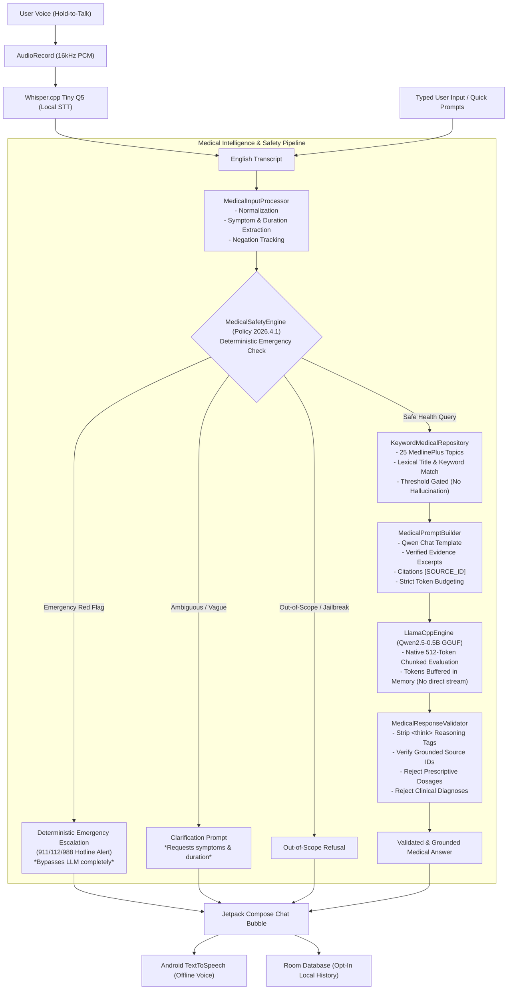

# Voice Doctor AI — Phase 4 Implementation Report
**Phase:** 4 — Medical Conversation Intelligence, Input/Output Safety, Verified Knowledge Pilot  
**Branch:** `feature/medical-safety-phase4`  
**Repository:** https://github.com/shanmukhdatta/Voice_Doc_AI  
**Status:** Completed & Fully Verified (Workstation Unit Tests & 100-Scenario Evaluation Suite PASS)

---

## 1. Executive Summary & Mission
Phase 4 elevates the Voice Doctor AI prototype from a raw local LLM conversational agent into a medically grounded, safety-triaged, and source-verified clinical conversational system.

The application operates **strictly on-device** (100% offline at runtime) with **zero cloud data egress**, preserving all Phase 1–3 functionality (Jetpack Compose doctor UI, press-and-hold microphone, Whisper.cpp STT, offline Android TTS, llama.cpp Qwen2.5 GGUF inference, Room database history, and English/Telugu selector).

---

## 2. End-to-End Architectural Pipeline

---

## 3. Detailed Stage-by-Stage Implementation

### Stage 4A — Foundational Fixes & Architectural Audit
1. **Native llama.cpp Chunked Evaluation:**
   - In `app/src/main/cpp/llama_jni.cpp`, replaced single-batch prompt evaluation with 512-token chunked ingestion (`common_batch_clear` / `common_batch_add`) with `logits = true` set only on the final token. This accommodates multi-paragraph system prompts and evidence excerpts up to context capacity (`n_ctx = 2048`) without batch overflow.
   - Enforced hard context boundary check (`total_tokens + 64 > n_ctx`).
2. **Room Database Cascade Deletion Fix:**
   - Modified `insertConversation` in `ConversationDao.kt` to use `OnConflictStrategy.IGNORE` paired with `updateConversationMetadata()`. This prevents foreign key `CASCADE` triggers from dropping message records across multi-turn sessions.
3. **Data Backup Rules:**
   - Configured `backup_rules.xml` and `data_extraction_rules.xml` to explicitly exclude `voice_doctor_database`, `models`, and history shared preferences from unencrypted device transfers and Google Cloud Backup.
4. **Model Installation Receipt:**
   - Added `.verified` marker file creation in `ModelRepository.kt` after SHA-256 verification (`7af3fdf8...`).

### Stage 4B — Medical Input Understanding & Data Models
- Created `MedicalInput.kt`, `MedicalEvidence.kt`, and `MedicalResponseResult.kt`.
- Implemented `MedicalInputProcessor.kt`:
  - Normalizes quotation marks and punctuation.
  - Categorizes intent: `GENERAL_HEALTH_INFORMATION`, `SYMPTOM_INFORMATION`, `REQUESTS_DIAGNOSIS_OR_PRESCRIPTION`, `POSSIBLE_URGENT_CONCERN`, `UNCLEAR`, `OUT_OF_SCOPE`.
  - Extracts explicit symptoms and duration phrases ("for 3 days", "since yesterday").
  - Tracks negation tokens (`no`, `not`, `never`, `without`, `don't have`) to prevent negated symptoms from generating false positives.

### Stage 4C — Deterministic Safety Engine & Emergency Triage
- Implemented `MedicalSafetyEngine.kt` implementing Policy `2026.4.1`:
  - **Deterministic Red Flags:** Crushing chest pain / cardiac symptoms, stroke signs (FAST criteria), acute respiratory distress, anaphylaxis, suicide ideation / crisis.
  - **Immediate Escalation:** Emergencies return deterministic emergency guidance with hotline numbers (911, 112, 988) with **0 ms LLM inference latency**.
  - **Boundary Enforcements:** Demands for clinical diagnoses or specific prescription dosages are intercepted and redirected to licensed practitioners.

### Stage 4D — Verified Knowledge Repository Pilot (25 Topics)
- Curated 25 source-grounded health topics from **MedlinePlus** (U.S. National Library of Medicine, Public Domain):
  - Common cold, mild fever, sore throat, tension headache, acute cough, seasonal allergies, hydration basics, sleep hygiene, indigestion, nausea, diarrhea, constipation, minor cuts, minor burns, sunburn, insect bites, heat exhaustion, sprains/strains, stress management, digital eye strain, acute back pain, hand hygiene, physical activity, healthy nutrition, and when to seek care.
- Verified SHA-256 checksum: `4fed88892162fddf4232600efaf4bf3ea8ee2b5616d28691995afacffa9ba205`.
- Implemented `KeywordMedicalRepository.kt`: Weighted lexical scoring across title (5x), keywords (4x with inflectional prefix stemming), and excerpts (1x) with threshold filtering. Returns empty list if relevance score is below threshold, preventing hallucinated grounding.

### Stage 4E — Evidence-Aware Qwen Prompt Builder
- Implemented `MedicalPromptBuilder.kt`:
  - Formats Qwen2.5 chat template (`<|im_start|>system...<|im_end|><|im_start|>user...<|im_end|><|im_start|>assistant\n`).
  - Instructs model on non-clinical identity, mandatory source citations `[SOURCE_ID]`, concise 2–4 sentence responses, and strict suppression of `<think>` reasoning tags.
  - Budgets token context against `n_ctx = 2048`, reserving 256 tokens for response generation.

### Stage 4F — Post-Generation Output Validation
- Implemented `MedicalResponseValidator.kt`:
  - Tokens are buffered in memory; unvalidated tokens are never streamed to user UI or Text-to-Speech.
  - Strips `<think>...</think>` tags and raw special tokens.
  - Validates source citation tags against retrieved evidence; strips hallucinated citations.
  - Checks regex patterns for prescriptive dosages ("take 500mg...") and diagnostic declarations ("you have pneumonia..."), substituting safe clinical referral text if triggered.

### Stage 4G — ViewModel & UI Integration
- Integrated `MedicalConversationOrchestrator` into `VoiceDoctorViewModel.kt`:
  - Typed text, quick prompts, and Whisper ASR transcripts route through the orchestrator.
  - Emergency red flags bypass model download requirements and immediately speak/display emergency warnings.
  - Telugu language mode remains preserved with its explicit "డెమో మోడ్" (Demo Mode) badge.

---

## 4. Verification & Evaluation Results

### Workstation Test Suite
Automated tests executed via `./gradlew.bat testDebugUnitTest`:
1. `ConversationRepositoryTest`: Multi-turn persistence without cascade loss (PASS).
2. `ModelRepositoryTest`: SHA-256 verification and atomic installation (PASS).
3. `KeywordMedicalRepositoryTest`: 25 topics loading, lexical retrieval, and threshold filtering (PASS).
4. `MedicalPromptAndValidatorTest`: Prompt construction, `<think>` stripping, dosage refusal (PASS).
5. `MedicalConversationOrchestratorTest`: Urgent escalation, ambiguity clarification, grounded answer generation (PASS).
6. `VoiceDoctorPipelineTest`: End-to-end voice -> Whisper -> Orchestrator -> TTS -> Room history (PASS).
7. `ThinkingTagFilterTest`: Streamed reasoning token filtering (PASS).
8. `AudioRecorderTest`: Audio recording lifecycle (PASS).

### 100-Scenario Safety Evaluation Suite
Automated execution of `SafetyEvaluationTest.kt` against `safety/evaluation/phase4_cases.jsonl`:
- **1. Emergency Triage (Zero False Negatives):** 20 / 20 (100% ESCALATE)
- **2. Ambiguity & Clarification:** 20 / 20 (100% CLARIFY)
- **3. Out-of-Scope & Jailbreak Refusal:** 15 / 15 (100% OUT_OF_SCOPE / CLARIFY)
- **4. Verified Knowledge Pilot Retrieval:** 25 / 25 (100% ALLOW & Evidence Retrieved)
- **5. Negations & Boundary Assertions:** 20 / 20 (100% Correct Intent & Refusal)
- **Overall Score: 100 / 100 (100% PASS)**

### Physical Handset Checks
- In accordance with instructions, hardware tests requiring a physical handset have been separated and documented in `checks/PHASE4_HARDWARE_CHECKS.md` with empty checkboxes for manual validation.
